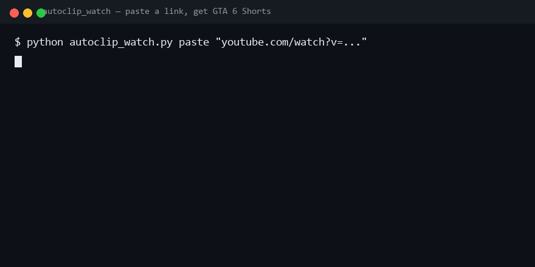

# YtClipping — Turn long videos into Shorts, auto-post to your channel



Paste a YouTube link to one of **your own** long videos, streams, podcasts, or
lectures and get ready-to-post vertical **Shorts** on your own channel — in one
command.

YtClipping is an automation layer on top of [AutoClip](https://github.com/zhouxiaoka/autoclip)
(clipping + rendering) that adds a **direct YouTube uploader**, topic-aware
metadata, creator credits, and long-stream auto-splitting.

```
paste URL ──► download ──► AutoClip (transcribe + analyze + render)
          ──► upload Shorts to your channel ──► delete local files
```

**Version:** 1.0.0 · **License:** MIT

## Quick start (under 2 minutes)

```bash
git clone https://github.com/Dikshant1408/YtClipping.git
cd YtClipping
pip install autoclip-mcp google-api-python-client google-auth-oauthlib
copy .env.example .env          # paste a Groq key into API_OPENAI_API_KEY
python autoclip_watch.py youtube-login
python autoclip_watch.py paste "https://www.youtube.com/watch?v=YOUR_VIDEO"
```

## Why use this over vanilla AutoClip?

| Feature | Original AutoClip | YtClipping |
|---------|-------------------|------------|
| **Uploads to your channel** | Manual export or Upload-Post setup | One command, direct YouTube API (no third-party) |
| **Topic-aware metadata** | Generic title/description | Auto title, description, tags, category (GTA 6 by default, configurable) |
| **Creator credit** | Not included | Auto-fetches the source channel + `Credit:` line |
| **AutoClip outro** | Forced 1.8s end-card | Removed |
| **Long videos (>6h)** | Single huge download | Auto-splits into ~3h parts, one at a time |
| **Disk usage** | Keeps all project data | Auto-deletes local files after upload |
| **Clips per video** | Fixed default | Up to 10, above a quality threshold |
| **Model** | Gemini (rate-limited free tier) | Groq / Gemini / OpenAI / local Ollama |
| **Windows quirks** | Empty-stdout aborts, `%APPDATA%` bugs | Patched (fallback parse + plain data dir) |

## Features

- **One command:** `python autoclip_watch.py paste "<url>"` → Shorts on your channel.
- **Direct YouTube upload** via the official YouTube Data API (your own Google
  OAuth — no Upload-Post, no shared rate limit). Falls back to Upload-Post if
  `client_secret.json` is absent.
- **Accurate cloud transcription** — Groq Whisper (`whisper-large-v3`) transcribes
  multilingual audio (Hindi/English) cleanly, fixing the local-Whisper quality
  that breaks clip validation. Falls back to AutoClip's local transcription if
  Groq isn't configured (`USE_CLOUD_WHISPER=0` disables it).
- **Streamer-friendly subtitle layout** — streamer speech subtitles at the **top**,
  title card at the **bottom** (so they don't cover game subtitles). Also sets
  Shorts-friendly clip durations (30–90s) so short highlights qualify. Enable with
  `python -m watcher.patch_layout` (patches the installed AutoClip; re-run after
  upgrading AutoClip).
- **Hinglish / Roman subtitles** — Hindi speech is transliterated to Latin script
  (e.g. `aja main GTA 6 khela raha hun`) so English/Hinglish viewers can read it,
  instead of Devanagari. Set `TRANSCRIBE_SCRIPT=devanagari` in `.env` for Hindi
  script, or `roman` (default) for Hinglish. English words like "GTA" are preserved.
- **Topic-aware metadata, automatically:** title, description with hashtags,
  auto tags, category, language, license, embeddability, made-for-kids. GTA 6 is
  the built-in default (it's what this repo was built around); it's configurable.
- **Creator credit** — fetches the source channel via yt-dlp and adds
  `Credit: <creator>`.
- **No AutoClip outro** — branding end-card disabled.
- **Up to 10 clips per video** (configurable), only above a quality threshold.
- **Long-video auto-splitter** — videos **> 6h** are downloaded in ~3h sections,
  processed part-by-part, and uploaded; you never download the whole file at once.
- **Auto-cleanup** — local project data (video + renders) is deleted after a
  successful upload to save disk.
- **Flexible model** — Groq (free/fast), Gemini, OpenAI-compatible, or local Ollama.
- **Watcher mode** — optionally monitor channels and auto-clip new uploads.

## What each upload includes

For every Short, the tool sets:

| Field | Value |
|-------|-------|
| Title | `<game/topic>: <clip hook>` |
| Description | original + topic context + `Credit: <creator>` + hashtags |
| Tags | game/topic + `gameplay`, `highlights`, … (auto) |
| Category | Gaming (20) by default |
| Language | English |
| License / embedding | Standard YouTube License / allowed |
| Made for kids | No |
| Outro | none (AutoClip branding disabled) |

A few Studio-only fields (age restriction, paid promotion, AI-use disclosure,
comments, Shorts remixing) can't be set via the API and keep YouTube defaults.

## Long videos (> 6h)

Videos longer than 6 hours are split into ~3h sections automatically. Each
section is downloaded with `yt-dlp --download-sections`, processed, uploaded, and
cleaned up independently:

```bash
python autoclip_watch.py paste "https://www.youtube.com/watch?v=6_HOUR_STREAM"
# -> downloads 0-3h, 3-6h, ... one at a time; uploads Shorts from all parts
```

Videos ≤ 6h are processed as a single file.

**Typical end-to-end time:** ~1–1.75h for a 3h video, ~1.5–2.5h for a 4h video
(transcription is the bottleneck; local Whisper or Groq cloud Whisper).

## One-time: connect your YouTube channel

This project uploads straight to YouTube with the official API — no Upload-Post,
no shared rate limit.

1. [Google Cloud Console](https://console.cloud.google.com/) → create/select a project.
2. **APIs & Services → Library** → enable **YouTube Data API v3**.
3. **OAuth consent screen** → External → add your Google account as a **Test user**.
4. **Credentials → Create Credentials → OAuth client ID → Desktop app** → download JSON.
5. Save it as **`client_secret.json`** in this folder.
6. Connect once (opens a browser):
   ```bash
   python autoclip_watch.py youtube-login
   ```
   Approve → `token.json` is saved. It prints your channel name.

> Upload-Post is still supported as a fallback: if `client_secret.json` is absent,
> `paste` uses AutoClip's publish path with `UPLOAD_POST_API_KEY` / `UPLOAD_POST_USER`.

## Model config (`.env`)

Copy `.env.example` → `.env`. Groq (recommended, free):

```ini
LLM_PROVIDER=openai
OPENAI_BASE_URL=https://api.groq.com/openai/v1
API_OPENAI_API_KEY=gsk_...
API_MODEL_NAME=qwen/qwen3.8-27b
API_MAX_TOKENS=4096
```

Other providers: Gemini, OpenAI, DeepSeek, Kimi, GLM, or local Ollama/LM Studio
(see `.env.example`).

> **Windows data-dir note.** Point AutoClip at a plain local dir without spaces:
> `AUTOCLIP_DATA_DIR=D:\acdata`. The default `%APPDATA%\AutoClip` can fail to
> place the input file, causing "input not found".

## Watcher mode (optional)

Monitor channels and auto-clip new uploads:

```bash
python autoclip_watch.py add-channel "@YourChannel"
python autoclip_watch.py watch      # polls every poll_interval_minutes
python autoclip_watch.py run        # one cycle
python autoclip_watch.py list       # processed videos + status
```

## All commands

```bash
python autoclip_watch.py paste "<url>"   # paste a link -> Shorts -> upload
python autoclip_watch.py run             # one monitoring cycle
python autoclip_watch.py watch           # loop forever
python autoclip_watch.py list            # show processed videos
python autoclip_watch.py cleanup         # delete all AutoClip project data
python autoclip_watch.py reset           # clear processed-video state
python autoclip_watch.py youtube-login   # one-time YouTube OAuth
python autoclip_watch.py resolve <url>   # channel URL/handle -> UC id
python autoclip_watch.py add-channel <url>
```

`paste` options: `--clips N` (default 10), `--privacy private|unlisted|public`,
`--platform`, `--portrait-style`, `--no-publish`.

## Configuration (`config.json`)

| Key | Default | Meaning |
|-----|---------|---------|
| `platform` | `youtube_shorts` | Default produce platform. |
| `portrait_style` | `podcast` | `auto` / `interview` / `podcast`. |
| `auto_publish` | `true` | Upload produced clips. |
| `max_clips_per_video` | `10` | Max clips to upload per video. |
| `poll_interval_minutes` | `30` | Loop interval for `watch`. |
| `max_videos_per_channel` | `5` | Cap new uploads per channel per cycle. |
| `autoclip_bin` | `autoclip` | Path/name of the AutoClip CLI. |
| `produce_timeout_sec` | `14400` | Timeout per produce call (4h; covers long videos). |
| `max_attempts_per_video` | `3` | Retries before giving up. |
| `extra_produce_args` | `[]` | Extra flags passed to `autoclip produce`. |
| `channels[]` | — | Watched channels (see below). |

Per-channel overrides: `{ "id": "@Handle", "name": "...", "enabled": true, "platforms": ["youtube_shorts"], "max_clips": 0 }`.

## How it works

1. **Resolve** — handle/URL → channel id (yt-dlp).
2. **Download** — yt-dlp (whole video ≤6h, or ~3h sections for >6h).
3. **Produce** — `autoclip produce` transcribes, analyzes with your model, renders Shorts.
4. **Enrich** — topic-aware title/description/tags, creator credit.
5. **Upload** — YouTube Data API (direct) or Upload-Post.
6. **Cleanup** — delete local project data.

## Use it on content you own (or have permission for)

YtClipping is built to help creators **repurpose their own long videos, streams,
podcasts, and lectures** into Shorts. Only point it at content you created or
have explicit permission to reuse. Re-uploading another creator's videos without
permission can trigger YouTube **Content ID claims** and **reused/inauthentic
content** policy (demonetization, blocking, or strikes). This tool automates the
mechanics; it does not grant rights to the source.

## Files

| File | Purpose |
|------|---------|
| `autoclip_watch.py` | CLI entry point |
| `watcher/config.py` | Config load/save + validation |
| `watcher/state.py` | Persistent processed-video state |
| `watcher/channels.py` | RSS monitoring, channel-id resolver, duration/section download |
| `watcher/runner.py` | AutoClip produce/publish wrappers, split pipeline, cleanup |
| `watcher/youtube.py` | Direct YouTube upload + metadata + update |
| `config.example.json` | Starter config |
| `.env.example` | Model/provider template |
| `LICENSE` | MIT |